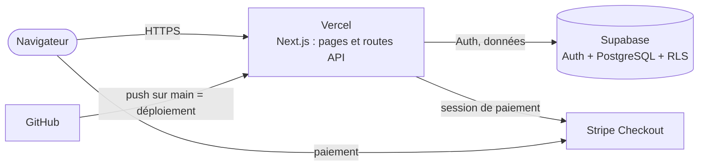

# Driveo : location de voitures de luxe

Site web de location de voitures de luxe : catalogue, prix recalculé en direct, compte client obligatoire, paiement en ligne (Stripe, mode test) et back-office administrateur.

**Site en ligne :** https://metricflow-tan.vercel.app
**Projet :** Holberton School, réalisé par Janice Kouakou (projet solo)

> Le dépôt s'appelle `metricflow` pour des raisons historiques : il a été réutilisé pour Driveo.

---

## Fonctionnalités

**Côté client**
- Catalogue de 12 voitures avec filtres par catégorie et fiche détaillée
- 6 agences (dont des points aéroport)
- Prix total recalculé en direct selon les dates et les options, avec remises automatiques (5 % dès 3 jours, 10 % dès 7 jours, 15 % dès 14 jours)
- Compte obligatoire avant de réserver (inscription et connexion avec Supabase Auth)
- Paiement en ligne sur la page Stripe Checkout (mode test)
- Page « Mes réservations » avec annulation
- Affichage adapté au mobile

**Côté administrateur** (page `/admin`, réservée aux admins)
- Onglets Réservations, Voitures, Agences, Clients
- Ajouter, modifier, masquer ou supprimer une voiture ou une agence, sans redéployer
- Un prix modifié est appliqué au prochain paiement

---

## Technologies

| Rôle | Outils |
|---|---|
| Frontend | Next.js 16 (Turbopack), React 19, TypeScript, Tailwind CSS 4 |
| Backend et données | Supabase (Auth, PostgreSQL, Row Level Security) |
| Paiement | Stripe Checkout (mode test) |
| Déploiement | Vercel, avec déploiement automatique depuis GitHub |
| Qualité | ESLint, compilateur TypeScript (`tsc --noEmit`), `next build` |
| Photos | Wikimedia Commons (licences libres) |

---

## Architecture



Principe : le navigateur n'a jamais le dernier mot. Le prix est recalculé par le serveur à partir des tarifs en base, et les droits sont appliqués dans la base de données (RLS).

### Parcours d'un paiement
1. Le client connecté envoie `POST /api/checkout` avec son jeton de connexion.
2. Le serveur vérifie le jeton, lit la voiture en base, recalcule le total et crée une session Stripe.
3. Le client paie sur la page Stripe, puis revient sur `/reservation/succes`.
4. Le front appelle `GET /api/checkout/verify` : si Stripe confirme le paiement, la réservation est enregistrée (un index unique sur `stripe_session` évite les doublons).

### Routes API internes

| Méthode | Route | Rôle | Erreurs |
|---|---|---|---|
| POST | `/api/checkout` | Crée la session de paiement (prix recalculé côté serveur) | `401` sans compte, `400` réservation invalide, `500` erreur Stripe |
| GET | `/api/checkout/verify?session_id=...` | Vérifie auprès de Stripe que la session est payée | `400` identifiant manquant, `500` erreur Stripe |

---

## Installation

### Prérequis
- Node.js 20 ou plus récent
- Un projet Supabase (gratuit)
- Un compte Stripe en mode test

### Étapes

```bash
git clone https://github.com/Janice91/metricflow.git
cd metricflow
npm install
```

Créer le fichier `.env.local` à la racine (il n'est pas versionné, voir `.gitignore`) :

```env
NEXT_PUBLIC_SUPABASE_URL=https://xxxxxxxx.supabase.co
NEXT_PUBLIC_SUPABASE_ANON_KEY=votre_cle_anon_publique
STRIPE_SECRET_KEY=sk_test_votre_cle_secrete_stripe
```

| Variable | Où la trouver | Visibilité |
|---|---|---|
| `NEXT_PUBLIC_SUPABASE_URL` | Supabase, Project Settings, API | Publique |
| `NEXT_PUBLIC_SUPABASE_ANON_KEY` | Supabase, Project Settings, API Keys, clé « anon » | Publique (protégée par le RLS) |
| `STRIPE_SECRET_KEY` | Stripe, Développeurs, Clés API (mode test) | **Secrète : serveur uniquement, jamais dans Git** |

Lancer le site :

```bash
npm run dev            # http://localhost:3000
npm run dev -- -p 80   # sur le port 80
```

Vérifications avant de déployer :

```bash
npx tsc --noEmit
npm run build
```

---

## Base de données

Dans Supabase, **SQL Editor, New query, Run**.

**1. Réservations**

```sql
create table if not exists bookings (
  id uuid default gen_random_uuid() primary key,
  user_id uuid references auth.users not null default auth.uid(),
  ref text not null,
  car_id text not null,
  pickup text,
  dropoff text,
  start_date date not null,
  end_date date not null,
  options text[] default '{}',
  total numeric not null,
  name text,
  email text,
  phone text,
  stripe_session text,
  created_at timestamptz default now()
);

-- Un paiement Stripe = une seule réservation
create unique index if not exists bookings_stripe_session_key
  on bookings (stripe_session) where stripe_session is not null;

alter table bookings enable row level security;
```

**2. Administrateurs**

```sql
create table if not exists public.admins (
  user_id uuid primary key references auth.users on delete cascade
);
alter table public.admins enable row level security;
create policy "Chacun lit sa ligne" on public.admins
  for select using (auth.uid() = user_id);

create or replace function public.is_admin()
returns boolean language sql security definer stable
set search_path = public as $$
  select exists (select 1 from public.admins where user_id = auth.uid());
$$;
```

**3. Règles de sécurité des réservations**

```sql
create policy bookings_read on bookings
  for select using (auth.uid() = user_id or public.is_admin());
create policy bookings_insert on bookings
  for insert with check (auth.uid() = user_id);
create policy bookings_delete on bookings
  for delete using (auth.uid() = user_id or public.is_admin());
```

**4. Catalogue (voitures et agences) et liste des clients**

```sql
create table if not exists public.cars (
  id text primary key, brand text not null, model text not null, category text not null,
  year int not null, price_per_day numeric not null, seats int default 4, doors int default 4,
  gearbox text default 'Auto', fuel text default 'Essence', luggage int default 2,
  color text default '#475569', rating numeric default 4.8, reviews int default 0,
  badge text, photo text, image_url text, description text default '',
  features text[] default '{}', active boolean default true, position int default 0
);
create table if not exists public.agencies (
  id text primary key, city text not null, address text default '', phone text default '',
  hours text default '', airport boolean default false, active boolean default true, position int default 0
);
alter table public.cars enable row level security;
alter table public.agencies enable row level security;

-- Lecture publique, écriture réservée aux admins
create policy cars_read on public.cars for select using (true);
create policy cars_admin on public.cars for all
  using (public.is_admin()) with check (public.is_admin());
create policy agencies_read on public.agencies for select using (true);
create policy agencies_admin on public.agencies for all
  using (public.is_admin()) with check (public.is_admin());

create or replace function public.admin_clients()
returns table (user_id uuid, email text, full_name text, created_at timestamptz,
               last_sign_in_at timestamptz, bookings bigint, spent numeric)
language plpgsql security definer set search_path = public, auth as $$
begin
  if not public.is_admin() then raise exception 'Acces reserve aux administrateurs'; end if;
  return query
    select u.id, u.email::text, coalesce(u.raw_user_meta_data->>'full_name','')::text,
           u.created_at, u.last_sign_in_at, count(b.ref), coalesce(sum(b.total),0)
    from auth.users u left join public.bookings b on b.user_id = u.id
    group by u.id order by u.created_at desc;
end $$;
grant execute on function public.admin_clients() to authenticated;
```

Si les tables `cars` et `agencies` sont vides, le site affiche les données du code (`lib/cars.ts`). L'administrateur peut ensuite les importer depuis l'onglet Voitures.

**5. Créer un administrateur** : créer d'abord le compte sur le site, puis dans le SQL Editor :

```sql
insert into public.admins (user_id)
select id from auth.users where email = 'votre-email@exemple.com';
```

---

## Tester le paiement (mode test)

Sur la page Stripe, utiliser une carte de test :

| Carte | Résultat |
|---|---|
| `4242 4242 4242 4242` | Paiement accepté |
| `4000 0000 0000 0002` | Paiement refusé |

Date d'expiration future quelconque, CVC à 3 chiffres quelconques. Aucun vrai paiement n'est effectué.

---

## Structure du projet

```
app/                    Pages et routes
  voitures/             Catalogue et fiche voiture
  reservation/          Formulaire, paiement et page de succès
  reservations/         Mes réservations
  login/                Inscription et connexion
  admin/                Back-office (4 onglets)
  api/checkout/         Routes API internes (paiement Stripe)
components/             Composants réutilisables (Navbar, CarCard, ...)
lib/                    Logique métier
  pricing.ts            Calcul du prix, remises, options
  serverCatalog.ts      Lecture du catalogue côté serveur
  catalog.tsx           Contexte React du catalogue
  catalogAdmin.ts       Écritures de l'administrateur
  auth.ts, admin.ts     Utilisateur et rôle admin
  bookings.ts           Réservations
docs/                   Documentation
public/                 Images
```

---

## Sécurité

- **Authentification** : Supabase Auth, jetons JWT.
- **Droits dans la base (RLS)** : un client ne lit et ne supprime que ses réservations ; seuls les administrateurs écrivent dans `cars` et `agencies`.
- **Prix** : recalculé côté serveur à partir des tarifs en base ; les champs de prix envoyés par le navigateur sont ignorés.
- **Compte obligatoire** : vérifié sur le bouton, sur la page de paiement et côté serveur (`401` sans jeton).
- **Paiement** : page hébergée par Stripe ; aucune donnée de carte ne passe par le site.
- **Secrets** : clé secrète Stripe uniquement côté serveur, `.env.local` exclu de Git.

Tests de sécurité réalisés le 03/11/2026 sur le site en ligne : accès `/admin` refusé à un client, appel `/api/checkout` sans compte refusé (401), faux prix ignoré, écriture dans `cars` refusée à un client.

---

## Déploiement

Chaque `push` sur la branche `main` déclenche un déploiement automatique sur Vercel. Les variables d'environnement (`NEXT_PUBLIC_SUPABASE_URL`, `NEXT_PUBLIC_SUPABASE_ANON_KEY`, `STRIPE_SECRET_KEY`) sont configurées dans Vercel, Settings, Environment Variables. La version rendue est étiquetée `v1.0.0`.

---

## Limites connues et suite

- Pas de webhook Stripe : la réservation est enregistrée par le navigateur après vérification du paiement. Si le client ferme la page juste après avoir payé, le paiement peut exister sans réservation.
- La disponibilité des voitures n'est pas encore contrôlée : deux réservations aux mêmes dates sont possibles.
- À venir : webhook Stripe signé, gestion des disponibilités, e-mail de confirmation, tests automatisés.

---

## Documentation

- `Driveo_Dossier_Stages_1-3.pdf` : dossier de projet (user stories, maquettes, architecture, base de données, API, plan qualité, justifications techniques)
- `Driveo_Sprint_Plan.pdf` : plan de sprint

## Crédits

Photos : Wikimedia Commons, licences libres. Projet pédagogique : le paiement fonctionne uniquement en mode test.
