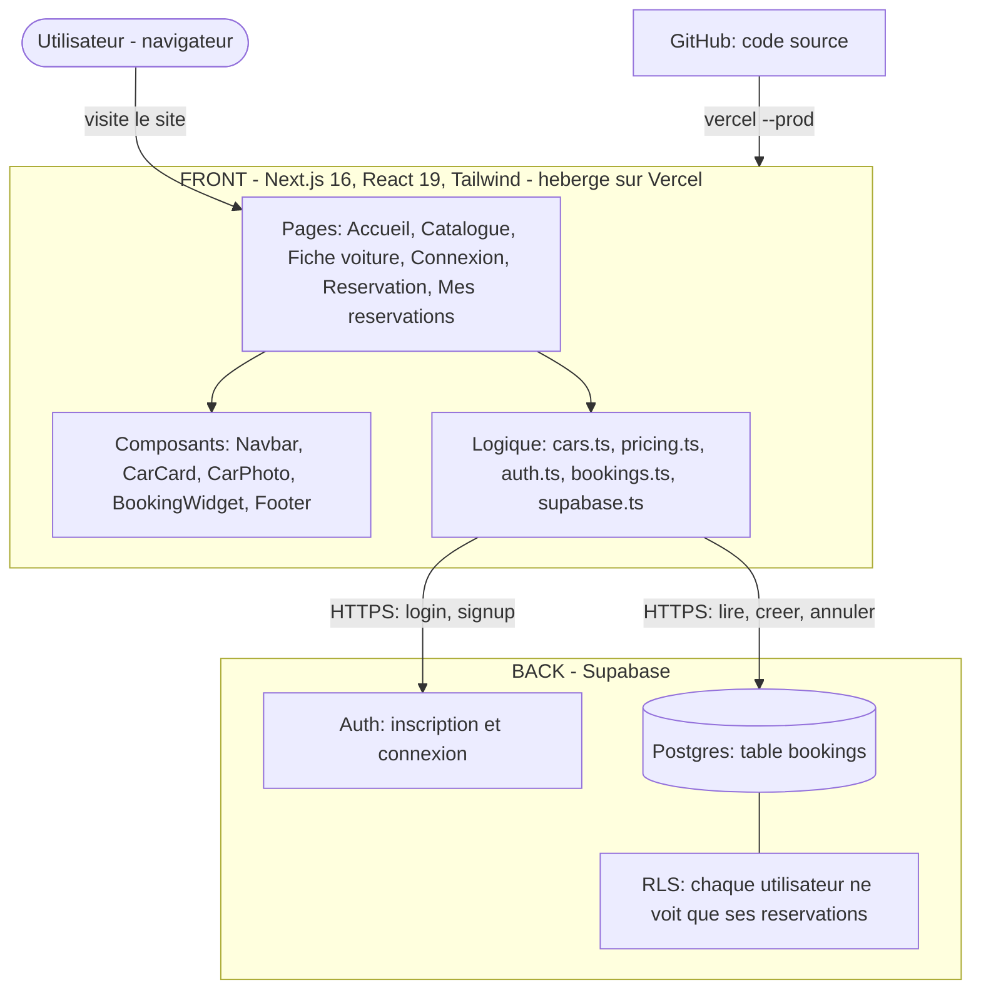
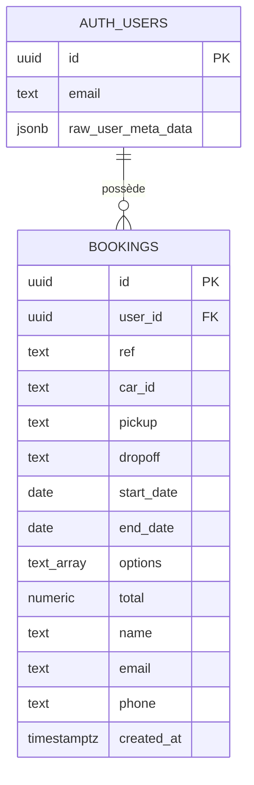

# Driveo - location de voitures de luxe

Next.js + TypeScript + Tailwind v4 + Supabase (comptes et reservations).

    npm install
    npm run dev -- -p 80

## Base de donnees

Supabase > SQL Editor > New query > Run :

    create table if not exists bookings (
      id uuid default gen_random_uuid() primary key,
      user_id uuid references auth.users not null default auth.uid(),
      ref text not null,
      car_id text not null,
      pickup text,
      dropoff text,
      start_date date not null,
      end_date date not null,
      options text[] default '{}',
      total numeric not null,
      name text,
      email text,
      phone text,
      created_at timestamptz default now()
    );

    alter table bookings enable row level security;

    create policy "Chacun gere ses reservations"
    on bookings for all
    using (auth.uid() = user_id)
    with check (auth.uid() = user_id);

## Photos

Placer les photos dans public/cars/ID.jpg (sinon un dessin est affiche).

## Architecture

## Database Diagram

La base de données est hébergée sur Supabase (PostgreSQL). Les voitures et les agences sont définies dans le code (`lib/cars.ts`). Seules les réservations sont stockées en base.

**Sécurité (RLS)** : la règle `auth.uid() = user_id` s'applique à toutes les opérations. Chaque utilisateur ne voit et ne modifie que ses propres réservations.
